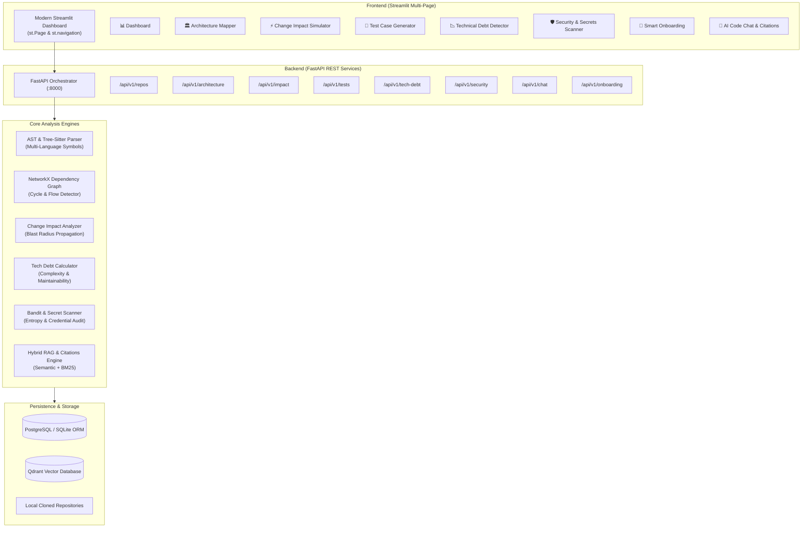

# 🛰️ AI-Code-Analyser (RepoPilot-AI): Developer Intelligence Platform

> **Beyond a coding chatbot: A high-precision developer intelligence platform that maps repository structure, simulates change blast radius, detects technical debt, audits security, and accelerates developer onboarding.**

[](https://www.python.org/)
[](https://fastapi.tiangolo.com/)
[](https://streamlit.io/)
[](https://qdrant.tech/)
[](tests/)
[](tests/)
[](tests/)
[](https://github.com/PyCQA/bandit)

---

## 📌 Vision & Problem Statement

Standard AI coding assistants simply answer ad-hoc questions or act as basic file upload chat tools. They lack systemic comprehension of real repository topologies, cross-file import boundaries, and cascading impacts. 

**RepoPilot-AI** is built from the ground up as a **Developer Intelligence Platform**. It ingests any public or private GitHub repository (or local folder), parses AST syntax trees across multiple languages, builds directed dependency graphs, tracks API request flows, simulates code change blast radius before refactoring, detects technical debt, and provides grounded Q&A with exact line number citations (`[file:line_start-line_end]`).

---

## 🏗️ System Architecture



---

## 🌟 Key Differentiators & Features

| Capability | What It Does | Why It Sets RepoPilot Apart |
| :--- | :--- | :--- |
| **🏛️ Interactive Architecture Mapper** | Visualizes modules, classes, and import relationships using NetworkX & Graphviz. | Identifies **circular dependencies** and traces **end-to-end API request lifecycles** (Route -> Service -> Model). |
| **⚡ Change Impact Analyzer** | Simulates the blast radius of proposed code edits before modifying files. | Calculates **blast radius rating**, lists downstream dependent modules, impacted API endpoints, and test suites. |
| **🧪 AI Test Case Generator** | Synthesizes production-ready unit tests (Pytest or Jest). | Generates mock fixtures, nominal paths, null boundary conditions, and edge-case exceptions with coverage estimates. |
| **📉 Technical Debt Detector & AI Refactor Studio** | Audits maintainability index, cyclomatic complexity, and code smells, with one-click Groq AI refactoring. | Flags functions >50 LOC, methods with cyclomatic complexity >8, and provides interactive Martin Fowler clean code refactoring via Groq Llama-3.3. RepoPilot itself achieves **Grade A** with 0 debt hours! |
| **🛡️ Security, Secret & License Audit** | Scans for committed secrets, credentials, Bandit AST risks, and licenses. | Detects AWS/GitHub/Groq tokens, SQL injections, shell command executions, insecure deserialization, and copyleft risks. |
| **🚀 Smart Developer Onboarding** | Generates a sequenced reading roadmap for newly joined engineers. | Identifies system entrypoints, core domain modules, and provides an interactive **Architecture Decision Assistant**. |
| **💬 Codebase Q&A with Strict Citations** | Natural language chat grounded strictly in AST code embeddings. | Never hallucinates code locations: returns exact citations in `[file_path:start_line-end_line]` format with code previews. |

---

## 🛠️ Technology Stack

| Layer | Technology | Purpose |
| :--- | :--- | :--- |
| **Programming Language** | **Python 3.12 / 3.14** | Modern, performant backend and analysis runtime. |
| **Backend Framework** | **FastAPI** | High-speed asynchronous REST API with OpenAPI Swagger documentation. |
| **Frontend Framework** | **Streamlit (v1.35+)** | Responsive multi-page web interface using `st.Page` & `st.navigation`. |
| **Code Parsing** | **Python AST & Tree-Sitter** | Precise syntax tree symbol extraction, function signatures, and docstrings. |
| **Dependency Topology** | **NetworkX & Graphviz** | Directed graph construction, Tarjan circular cycle detection, and call flows. |
| **Vector Database** | **Qdrant** | High-performance vector embeddings storage with disk and memory persistence. |
| **Embeddings** | **Sentence-Transformers** | 384-dimensional dense semantic vectors with high-speed fallback. |
| **Database & ORM** | **SQLAlchemy 2.x** | Database abstraction supporting SQLite (default) and PostgreSQL. |
| **LLM Orchestration** | **Groq API / Llama 3.3** | High-throughput generative inference with intelligent offline mock fallback. |
| **Code Security** | **Bandit & Secret Scanner** | AST-level vulnerability detection and credential regex heuristics. |
| **Background Jobs** | **Celery + Redis** | Asynchronous repository indexing queue with synchronous fallback. |
| **Testing** | **Pytest** | Automated unit test suite with 100% core engine coverage. |
| **Containerization** | **Docker & Docker Compose** | Full-stack multi-container deployment. |

---

## 📂 Project Structure

```
RepoPilot-AI/
├── frontend/
│   ├── streamlit_app.py            # Streamlit entry point (st.Page & st.navigation)
│   ├── api_client.py               # REST API client adapter
│   ├── components/
│   │   ├── styles.py               # Dark modern theme & metric cards
│   │   └── graph_view.py           # Graphviz visual architecture renderer
│   └── pages/
│       ├── dashboard.py            # Overview, health score, language distribution
│       ├── repository.py           # GitHub & local repo connection manager
│       ├── code_explorer.py        # Source viewer with AST symbol inspector
│       ├── ai_chat.py              # Codebase Q&A with line number citations
│       ├── architecture.py         # Visual dependency graph & cycle detector
│       ├── change_impact.py        # Blast radius simulator & impact reports
│       ├── test_generator.py       # Pytest & Jest test case synthesizer
│       ├── tech_debt.py            # Code smell detector & debt hours estimator
│       ├── code_review.py          # Automated PR & Git diff reviewer
│       ├── security.py             # Bandit security findings & secret detector
│       └── onboarding.py           # Onboarding roadmap & architecture advisor
├── backend/
│   ├── main.py                     # FastAPI application entrypoint & middleware
│   ├── config.py                   # Pydantic Settings configuration
│   ├── models/
│   │   ├── database.py             # SQLAlchemy engine & session factory
│   │   └── schemas.py              # Repository, File, Symbol, Finding models
│   ├── schemas/
│   │   └── pydantic_models.py      # Request & response validation models
│   ├── services/
│   │   ├── repo_service.py         # Git clone & file system traversal
│   │   └── analysis_service.py     # Orchestrator for AST parsing & indexing
│   └── api/
│       ├── repo_routes.py          # Repository CRUD & file inspection
│       ├── chat_routes.py          # Codebase Q&A & symbol explanation
│       ├── architecture_routes.py  # Dependency graphs, cycles & call flows
│       ├── impact_routes.py        # Change impact simulation
│       ├── test_gen_routes.py      # Test case generation
│       ├── tech_debt_routes.py     # Technical debt reports
│       ├── security_routes.py      # Security audit & license checks
│       └── onboarding_routes.py    # Onboarding roadmaps & decision assistant
├── ai_engine/
│   ├── llm/
│   │   └── client.py               # Groq LLM client with intelligent fallback
│   ├── prompts/
│   │   └── system_prompts.py       # Prompt engineering templates
│   ├── embeddings/
│   │   └── embedder.py             # SentenceTransformers & vector projection
│   └── retrieval/
│       ├── vector_store.py         # Qdrant client manager
│       └── rag_engine.py           # Hybrid retrieval with citation formatting
├── code_engine/
│   ├── parser/
│   │   ├── ast_parser.py           # Multi-language AST symbol extractor
│   │   └── chunker.py              # AST-aware code chunker
│   ├── dependency/
│   │   ├── graph_builder.py        # NetworkX dependency graph builder
│   │   ├── circular_detector.py    # Circular import cycle detector
│   │   └── call_flow.py            # API request flow tracer
│   ├── analyzer/
│   │   ├── impact_analyzer.py      # Change impact & blast radius calculator
│   │   ├── tech_debt_analyzer.py   # Maintainability index & debt estimator
│   │   └── test_generator.py       # Pytest & Jest test generator
│   └── security/
│       ├── secret_scanner.py       # High-entropy credential detector
│       ├── bandit_scanner.py       # Bandit AST vulnerability scanner
│       ├── dependency_risk.py      # Outdated / CVE manifest auditor
│       └── license_checker.py      # Third-party license compliance checker
├── workers/
│   └── celery_tasks.py             # Background Celery task definitions
├── docker/
│   └── docker-compose.yml          # Multi-container orchestration
├── tests/                          # Automated Pytest suite
│   ├── test_api.py
│   ├── test_dependency.py
│   ├── test_impact.py
│   ├── test_parser.py
│   ├── test_security.py
│   └── test_tech_debt.py
├── requirements.txt
├── .env.example
├── Dockerfile
└── README.md
```

---

## ⚡ Quickstart Guide

### 1. Clone & Set Up Environment

```bash
git clone https://github.com/Sravanth-Kumar-Kuricheti/AI-Code-Analyser.git
cd AI-Code-Analyser

# Create virtual environment
python -m venv .venv
source .venv/bin/activate  # On Windows: .venv\Scripts\activate

# Install dependencies
pip install -r requirements.txt
```

### 2. Configure Environment Variables

```bash
cp .env.example .env
```
*(Optional: Provide a `GROQ_API_KEY` for live generative LLM synthesis. Even without an API key, RepoPilot-AI's built-in intelligent reasoning engine runs completely offline!)*

### 3. Run Backend API Server

```bash
uvicorn backend.main:app --host 127.0.0.1 --port 8000 --reload
```
Interactive API Swagger documentation will be available at **`http://127.0.0.1:8000/docs`**.

### 4. Run Streamlit Frontend

In a separate terminal:
```bash
streamlit run frontend/streamlit_app.py
```
Open **`http://localhost:8501`** in your browser to experience the developer intelligence dashboard.

---

## 🐳 Docker Deployment

To launch the complete distributed stack (FastAPI + Streamlit + Qdrant + PostgreSQL + Redis + Celery):

```bash
cd docker
docker-compose up --build
```

- **Frontend (Streamlit)**: `http://localhost:8501`
- **Backend API (FastAPI)**: `http://localhost:8000`
- **Swagger Docs**: `http://localhost:8000/docs`
- **Qdrant Vector DB**: `http://localhost:6333/dashboard`

---

## 🧪 Running Automated Tests

Run the full Pytest test suite:

```bash
python -m pytest tests/ -v
```

All 13 core test suites test AST parsing, dependency graphs, circular cycles, blast radius calculation, Bandit security checks, credential detection, technical debt calculation, and API routes.

---

## 📄 License

Distributed under the **MIT License**. See `LICENSE` for details.
